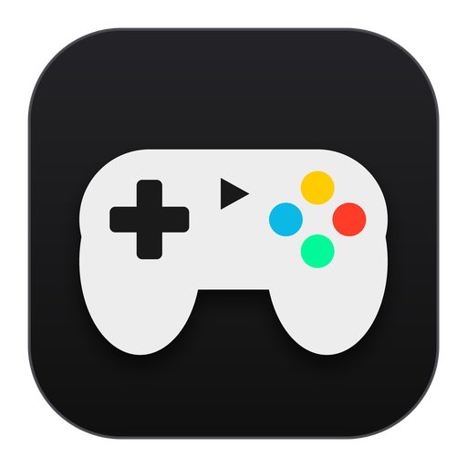

#  Ryujinx Launcher

***Version 1.2.0***

# 
---

**A controller-first configuration interface for Ryujinx.**

Ryujinx Launcher is standalone middleware designed to eliminate the Keyboard and Mouse dependency in HTPC and Couch Gaming setups. It solves the frustration of shifting controller IDs by allowing you to visually assign physical controllers to Player Slots (1-8) using only a gamepad immediately before launch.

With features like hot-plug detection and a controller-based "Kill Combo" for exiting, it maintains complete immersion by removing the need to ever reach for a mouse or keyboard to fix configs or close the emulator.

**Note:** This project is a **companion utility/launcher**. It does not replace, fork, or modify the original Ryujinx emulator; it is intended to be used alongside it to streamline the input configuration process.

---

## Why use Ryujinx Launcher?
**No More Controller Shuffling:** Fixed the frustration of shifting controller IDs. If your Bluetooth controller connects in a different order, you can re-map it in seconds using only your gamepad.

**Total Immersion:** Designed specifically for HTPCs, Handheld PCs (Steam Deck/ROG Ally), and Couch Gaming where reaching for a mouse is a literal chore.

**The "Emergency Exit":** Beyond just launching, it adds a controller-based "Kill Combo." If Ryujinx hangs or you're done playing, you can force-close the emulator without ever leaving your seat.

**Visual & Intuitive:** Features a high-contrast side-rail UI with persistent pastel color-coding so you always know which controller belongs to which player at a glance.

**Verified on Windows 11 and Ubuntu 24.04 (VM). Tested with Ryujinx versions v1.1.1403 through v1.3.3, including Canary builds v1.3.205 and v1.3.252.**

---

## ⚠️ Important Usage Note
While you *can* run this launcher directly to set up your controllers before launching Ryujinx, **game selection will still require a mouse to navigate.**

**The ideal use cases:** 
1) **Middleware**: Use this launcher as Middleware for frontends like **Playnite, Moonlight, Artemis**. When used this way, the frontend handles game selection, and this launcher handles the controller setup, creating a seamless, mouse-free experience from start to finish.
2) **Drop-in Replacement**: This launcher works as a direct replacement for any script, shortcut, command line argument or any other frontend that supports custom emulator paths. Wherever you currently use: `Ryujinx.exe <GamePath>`. You can simply replace it with: `RyujinxLauncher.exe <GamePath>`

---

## ✨ Features

* **Gamepad-First UI:** Assign up to 8 controllers without touching a keyboard or mouse.
* **Controller Profile Selection:** Switch between saved controller profiles (button mappings, deadzone settings, etc.) directly from the launcher UI using only your gamepad — no need to open Ryujinx settings.
* **Visual Identity:** Controllers are assigned persistent, unique pastel colors for easy identification.
* **Side-Rail Interface:** Clean, high-contrast UI with visual indicators for active status.
* **Hot-Plug Support:** Connect or disconnect controllers in real-time with automatic reconnection.
* **Emergency Kill Combo:** Hold **Back** + **L** + **R** (Select + LB + RB) on *any* connected controller to force-kill the emulator if it freezes.
* **Smart Persistence:** Uses HID paths to remember specific controllers even if they reconnect in a different order.
* **Frontend Ready:** Seamlessly passes command-line arguments (Playnite, Moonlight, Artemis).
* **Portable:** Single-file EXE with embedded assets.

---

## 🎮 Controls

| Action | Button (Xbox/Generic) |
| :--- | :--- |
| **Assign Player** | `Ⓐ` Button |
| **Remove Player** | `Ⓑ` Button |
| **Open Profile Selector** | `Ⓧ` Button (on an assigned slot) |
| **Browse Profiles** | `D-pad ◄ ►` or Left Stick |
| **Confirm Profile** | `Ⓐ` Button |
| **Cancel Profile Edit** | `Ⓑ` Button |
| **Launch Game/Ryujinx** | `☰` Button |
| **Exit Launcher** | `⧉` |
| **Force Kill Emulator** | Hold `⧉` + `LB` + `RB` (approx. 1 sec) |

---

## 🎛️ Controller Profile Selection

The launcher lets you pick a **controller profile** (button mappings, deadzone, stick sensitivity, etc.) for each player slot — all from your gamepad.

### How It Works

1. **Assign a controller** to a player slot with `Ⓐ`.
2. Press `Ⓧ` on that slot to enter **Profile Selection Mode**.
3. Use **D-pad ◄ ►** or **Left Stick** to browse available profiles.
4. Press `Ⓐ` to **confirm** or `Ⓑ` to **cancel**.

### Profiles

| Profile | Description |
| :--- | :--- |
| **RL Default** | The controller mapping template from your existing `Config.json`. This is selected by default. |
| **Custom Profiles** | Any `.json` files saved in Ryujinx's `profiles/controller/` directory. |

### Creating Profiles

Profiles are created using **Ryujinx's built-in profile save** feature:

1. Open **Ryujinx → Options → Settings → Input**.
2. Configure your controller (button mappings, deadzone, stick sensitivity, motion, rumble, etc.).
3. Type a **Profile Name** in the profile field and click **Save**.
4. The profile is saved as a `.json` file in Ryujinx's `profiles/controller/` directory.
5. The launcher will automatically detect it the next time it starts.

> **Tip:** To set a personalized default, save a profile named **"RL Default"** in Ryujinx — the launcher will automatically use it instead of the `Config.json` template.

Profile choices are remembered per controller (by HID path), so reconnecting the same gamepad restores its last-used profile.

---

## 🚀 Installation & Setup

### 1. Standard Method (Recommended)

Simply place `RyujinxLauncher.exe` inside your main Ryujinx directory (the same folder where `Ryujinx.exe` is located).

```text
C:\Games\Ryujinx\
    ├── Ryujinx.exe
    ├── RyujinxLauncher.exe  <-- Place here
    ├── Ryujinx.SDL2.Common.dll.config
    └── SDL2.dll

```
### 2. Advanced Method (Custom Path)

If you prefer to keep the launcher in a different folder than your emulator, you can manually link them:

1. Create a new text file named `RyujinxPath.config` in the same folder as the launcher.
    - Important: You must delete the .txt extension. The final file name must be exactly `RyujinxPath.config` (not `RyujinxPath.config.txt`).
2. Open it and paste the full path to your Ryujinx folder inside.
3. Save the file.

Example `RyujinxPath.config` content: `D:\emulators\Ryujinx`

**⚠️ Warning**: If you are unsure what this means, please use the **Standard Method above**. This step is only for users who need a specific custom folder structure.

---

## 🌱 Eden Support (Experimental)

The same launcher is also built for **Eden** (yuzu fork) as `EdenLauncher`.
Controls, kill combo, hot-plug and profile selection behave exactly as above.

**Setup**

* Place `EdenLauncher.exe` next to `eden.exe` (Linux: next to `Eden*.AppImage`;
  macOS: next to `eden.app`), or point to it with an `EdenPath.config` file.
* Open Eden once, go to **Emulation → Configure → Controls**, map **any
  gamepad** to Player 1 and press **OK**. That mapping becomes the
  **RL Default** profile and is re-targeted to every pad you assign.

**Where the launcher looks for `qt-config.ini`**

| Mode | Path |
| :--- | :--- |
| Portable (Windows) | `<eden.exe dir>\user\config\qt-config.ini` |
| Portable (macOS) | `<folder holding eden.app>/user/config/qt-config.ini` |
| Portable (Linux) | `<working dir>/user/config/qt-config.ini` |
| Windows | `%APPDATA%\eden\config\qt-config.ini` |
| Linux / macOS | `$XDG_CONFIG_HOME/eden/qt-config.ini` (default `~/.config/eden/`) |

**Profiles** are Eden's own input profiles (`input/*.ini` next to
`qt-config.ini`), created from Eden's Controls dialog. Keyboard-only profiles
are hidden. Only Players 1–8 are rewritten; every other setting is preserved.

> **Note:** Use docked mode, and make sure per-game configurations do not
> override input, otherwise Eden ignores the launcher's assignment.

---

## 🌐 Ryujinx-Nextendo Support

[Ryujinx-Nextendo](https://git.nextendo.network/NextendoNetwork/Ryujinx-Nextendo)
gets its own, fully independent launcher, `NextendoLauncher`. It shares only
the emulator-agnostic `Core/` with RyujinxLauncher. Use each launcher only
with its own emulator: RyujinxLauncher for official Ryujinx, NextendoLauncher
for Nextendo. Controls, kill combo, hot-plug and profile selection behave the
same in both.

**Setup**

* Keep Nextendo in **its own folder**, separate from official Ryujinx (both
  ship as `Ryujinx.exe`).
* Place `NextendoLauncher.exe` next to Nextendo's `Ryujinx.exe`, or point to
  it with a `NextendoPath.config` file.

**Data folder: always portable**

Nextendo writes config version 76, which official Ryujinx cannot read. If both
share a data folder, official Ryujinx renames the file to
`(invalid) Config.json.<date>.json` and resets every setting.

NextendoLauncher **never uses `%APPDATA%\Ryujinx`**. It uses the folder given
with `-r` / `--root-data-dir`, otherwise `<Nextendo folder>\portable\`, which
it creates if missing, so Nextendo itself also starts in portable mode.

---

## 🧩 Citron, Citron-Nextendo and Azahar Support

Each emulator has its own, fully independent launcher. They share only the
emulator-agnostic `Core/`; use each one only with its own emulator.

| Launcher | Emulator | Binary | Players | Config the launcher edits |
| :--- | :--- | :--- | :--- | :--- |
| `CitronLauncher` | [Citron nightly](https://github.com/citron-neo/CI) | `citron.exe` | 1-8 | `user\config\qt-config.ini` |
| `CitronNextendoLauncher` | [Citron-Nextendo](https://git.nextendo.network/NextendoNetwork/citron-nextendo) | `citron.exe` | 1-8 | `user\config\qt-config.ini` |
| `AzaharLauncher` | [AzaharPlus](https://github.com/AzaharPlus/AzaharPlus) | `azahar.exe` | 1 | `user\config\qt-config.ini` |

**Setup**

* Keep every emulator in **its own folder**. Both Citron builds ship as
  `citron.exe`.
* Place the launcher next to the emulator binary, or point to it with a
  `<Name>Path.config` file (`CitronPath.config`, `CitronNextendoPath.config`,
  `AzaharPath.config`).
* Open the emulator once and map any gamepad in its Controls dialog: that
  mapping is what the launcher re-targets to the pad you assign.
  * **Citron:** map Player 1 and press OK. That becomes the **RL Default**
    profile; profiles saved in `user\config\input\` are listed too.
  * **Azahar:** the launcher lists Azahar's own input profiles that use a
    gamepad. The one you pick becomes the active profile and is pointed at
    the assigned pad.

**Data folder: always portable**

These launchers **never use `%APPDATA%`**. Without a `user\` folder next to
the binary, both Citron builds would share `%APPDATA%\citron` (and the
Citron-Nextendo zip ships without one). Each launcher creates `user\` when it
is missing, so the emulator itself also starts in portable mode.

**Azahar needs `SDL2.dll`:** AzaharPlus has SDL built in, so the launcher
needs its own copy to read controllers. Place `SDL2.dll` (from the
`SDL2-<version>-win32-x64.zip` release at
[libsdl-org/SDL](https://github.com/libsdl-org/SDL/releases)) next to
`azahar.exe` or next to `AzaharLauncher.exe`.

---

## 🕹️ PCSX2, DuckStation, xemu and melonDS Support

Each emulator has its own, fully independent launcher (they share only
`Core/`). Place the launcher next to the emulator binary, or point to it with
`<Name>Path.config` (`PCSX2Path.config`, `DuckStationPath.config`,
`XemuPath.config`, `MelonDSPath.config`).

| Launcher | Emulator | Players | Portable mode (created if missing) | What the launcher writes |
| :--- | :--- | :--- | :--- | :--- |
| `PCSX2Launcher` | PCSX2 (`pcsx2-qt.exe`) | 1-8 | `portable.ini` | `inis\PCSX2.ini` `[Pad1]`..`[Pad8]` |
| `DuckStationLauncher` | DuckStation (`duckstation-qt-*.exe`) | 1-8 | `portable.txt` | `settings.ini` `[Pad1]`..`[Pad8]` |
| `XemuLauncher` | xemu (`xemu.exe`) | 1-4 | `xemu.toml` next to the exe | `[input.bindings]` `port1`..`port4` |
| `MelonDSLauncher` | melonDS (`melonDS.exe`) | 1 | `portable\` folder (or the exe folder if `melonDS.toml` is already there) | `[Instance0]` `JoystickID` |

None of them ever uses `%APPDATA%` or `Documents`.

**PCSX2 and DuckStation**

* Map a controller once to Controller Port 1 with the **SDL** or **XInput**
  input source (Automatic Mapping works). That mapping is the **RL Default**
  profile; profiles in `inputprofiles\` are listed too.
* With an XInput mapping, Xbox-style pads are written as `XInput-<slot>`;
  any other pad (DualShock, Switch...) is written as `SDL-N` with the button
  names translated, so mixing controller types still works.
* Both name a pad `SDL-N`, where N is the player index SDL gives it. The
  launcher loads the emulator's own `SDL3.dll` and the same SDL hints
  (including your `[SDLHints]`), so it computes the same N.
* More than 2 players needs the multitap: the launcher turns it on for
  port 1 (up to 5 players) and then port 2 (up to 8). It never turns a
  multitap off. Pads that are not assigned are set to `Type = None`.

**xemu:** binds ports by SDL GUID. Two identical controllers cannot be told
apart; they take their ports in connection order. xemu has SDL built in, so
place `SDL3.dll` (from `SDL3-<version>-win32-x64.zip` at
[libsdl-org/SDL](https://github.com/libsdl-org/SDL/releases)) next to
`xemu.exe` or next to `XemuLauncher.exe`.

**melonDS:** single player. Map a controller once in **Config > Input and
hotkeys** (Joystick side); the launcher only selects which pad uses it. It
needs the `SDL2.dll` next to `melonDS.exe` (or next to the launcher).

---

## 🎲 Cemu, Mesen, gopher64, mGBA and PPSSPP Support

Each emulator has its own, fully independent launcher (they share only
`Core/`). Place the launcher next to the emulator binary, or point to it with
`<Name>Path.config` (`CemuPath.config`, `MesenPath.config`,
`Gopher64Path.config`, `MGBAPath.config`, `PPSSPPPath.config`).

| Launcher | Emulator | Players | Portable mode (created if missing) | What the launcher writes | Pads it can pin |
| :--- | :--- | :--- | :--- | :--- | :--- |
| `CemuLauncher` | Cemu (`Cemu.exe`) | 1-8 | `portable\` folder (or the exe folder if `settings.xml` is there) | `controllerProfiles\controllerN.xml` `<uuid>` | XInput API: XInput pads. SDLController API: any pad |
| `Gopher64Launcher` | gopher64 | 1-4 | `portable.txt` | `portable_data\config\config.json` `controller_assignment` | Any pad |
| `MesenLauncher` | Mesen 2 (`Mesen.exe`) | 1-2 | `settings.json` next to the exe | XInput key codes of Player 1 / Player 2 | XInput pads |
| `MGBALauncher` | mGBA (`mGBA.exe`) | 1 | `portable.ini` | `config.ini` `[gba.input.SDLB] device0` | Any pad |
| `PPSSPPLauncher` | PPSSPP (`PPSSPPWindows64.exe`) | 1 | `memstick\`, or the folder written in `installed.txt` (an empty `installed.txt` is refused) | `controls.ini` XInput device ids | XInput pads |

None of them ever uses `%APPDATA%` or `Documents`.

* **Cemu:** set each Controller N up once in **Options > Input settings**
  (SDLController or XInput API). Each player's own `controllerN.xml` is the
  **RL Default** profile; named profiles you save in Cemu are listed too. A
  game profile that forces a controller profile overrides the launcher.
* **gopher64:** open it once so it creates its config; its input profiles
  are listed in the launcher.
* **Mesen:** used for NES, SNES, Game Boy and Game Boy Color. On Player 1
  of each console, pick an Xbox preset or map an Xbox-style pad once; Player 2
  (NES/SNES) reuses that layout if it has no XInput mapping of its own. Mesen
  reads pads through XInput, so only XInput pads can be pinned; a player left
  unassigned is moved off the pads given to others.
* **mGBA:** single player; mGBA's own button mapping is kept.
* **PPSSPP:** single player. With a folder written in `installed.txt`,
  PPSSPP keeps its whole memstick there, config included
  (`<folder>\PSP\SYSTEM\controls.ini`). Its XInput mappings are moved to the
  assigned pad's XInput slot; keyboard and DirectInput mappings stay.
* Cemu, gopher64, Mesen and PPSSPP need an `SDL3.dll` next to the emulator
  (or the launcher) because they have SDL built in or do not use it; mGBA
  uses the `SDL2.dll` it ships with.

---

## 🕹️ RetroArch (FinalBurn Neo) and Dolphin (GameCube) Support

Independent launchers, like the others. Place them next to the emulator or
use `RetroArchPath.config` / `DolphinPath.config`.

| Launcher | Emulator | Players | Portable mode (created if missing) | What the launcher writes | Pads it can pin |
| :--- | :--- | :--- | :--- | :--- | :--- |
| `RetroArchLauncher` | RetroArch (`retroarch.exe`) | 1-`input_max_users` (max 8) | `retroarch.cfg` next to the exe | `input_playerN_joypad_index`, and Player 1's joypad binds copied to every assigned player | Any pad (sdl2 joypad driver) |
| `DolphinLauncher` | Dolphin (`Dolphin.exe`) | 1-4 | `portable.txt` (data in `User\`) | `GCPadNew.ini` `[GCPadN]` (Device + profile), `Dolphin.ini` `SIDeviceN` | XInput pads as `XInput/<slot>/Gamepad`, others as `SDL/<n>/<name>` |

* **RetroArch:** needs `input_joypad_driver = "sdl2"` and the `SDL2.dll`
  next to `retroarch.exe`. Map Player 1 once (Settings > Input > Port 1
  Controls); that mapping is the profile for every player. Hotkeys are left
  as they are: RetroArch gates all of them behind `input_enable_hotkey`.
  Only the menu combo is set (L3 + R3).
  Playnite arguments: `-L ".\cores\fbneo_libretro.dll" "{ImagePath}"`.
* **Dolphin:** map GameCube Port 1 once (Controllers > Port 1 > Configure);
  `[GCPad1]` is the **Default** profile and every `Profiles\GCPad\*.ini` is
  listed too. Assigned ports get a GameCube controller in `SIDeviceN`;
  unassigned ports that had one are emptied (other device types are kept).
  Needs an `SDL3.dll` next to Dolphin or the launcher.
  Playnite arguments: `--exec="{ImagePath}" --batch`.

---

## 🎮 BizHawk (Mega Drive / Genesis) Support

Independent launcher, like the others. Place it next to `EmuHawk.exe` or use
`BizHawkPath.config`.

| Launcher | Emulator | Players | Portable mode | What the launcher writes | Pads it can pin |
| :--- | :--- | :--- | :--- | :--- | :--- |
| `BizHawkLauncher` | BizHawk (`EmuHawk.exe`) | 1-2 | Always: `config.ini` next to the exe | `config.ini` `AllTrollers` > `GPGX Genesis Controller` (and `PicoDrive Genesis Controller`): `X<n>` pad binds of `P1`/`P2` | Any SDL game controller |

* Load a Mega Drive game once and map Player 1 in *Config > Controllers*
  (Xbox-style pads are mapped by default), then close BizHawk. Player 1's pad
  layout is copied to every assigned player and moved to that player's pad
  (`X<n>`, n = SDL2 device order). Keyboard keys are kept.
* The launcher uses BizHawk's own `dll\SDL2.dll`, so pads are numbered the
  same way. No hotkeys are written.
* Playnite arguments: `"{ImagePath}"`.

---

## 🎮 Controller Hotkeys

At every launch the launcher writes these hotkeys for **Player 1's pad**, so
they follow whichever controller you assign. Your own bindings (e.g.
keyboard `Tab`, `F1`) are kept. Select is never used: too many games need it.

### Summary

| Emulator | R3 | L3 | L1 + L3 | R1 + R3 | L3 + R3 |
| :--- | :--- | :--- | :--- | :--- | :--- |
| Mesen | Fast-forward (hold) | Rewind (hold) | Save state | Load state | — |
| DuckStation | Fast-forward (hold) | Rewind (hold) ¹ | Save state | Load state | — |
| PCSX2 | Fast-forward (hold) | — | Save state | Load state | — |
| PPSSPP | Fast-forward (hold) | Rewind (one step per press) ² | — | — | — |
| melonDS | Swap screens | Slow motion (hold) | — | — | — |
| Azahar | — | — | — | — | Swap screens |
| RetroArch (FBNeo) | — | — | — | — | Open menu |

¹ Enable *Settings > Emulation > Rewind*. ² Set *Settings > System > Rewind snapshot interval*.

Save / load always use the **selected slot**. Press **L1 / R1 first**, then
the stick click: pressed alone, the stick click starts rewind / fast-forward
for an instant.

R3 / L3 still reach the game: in PS1/PS2 games that use stick clicks they
also trigger the hotkey.

### Per emulator

**Mesen** (`settings.json`, `Preferences.ShortcutKeys`, second key combination of each shortcut)
- R3 → `FastForward` (hold) · L3 → `Rewind` (hold)
- L1 + L3 → `SaveState` · R1 + R3 → `LoadState` (on press)

**DuckStation** (`settings.ini`, `[Hotkeys]`)
- R3 → `FastForward` (hold) · L3 → `Rewind` (hold)
- L1 + L3 → `SaveSelectedSaveState` · R1 + R3 → `LoadSelectedSaveState` (on release)

**PCSX2** (`PCSX2.ini`, `[Hotkeys]`)
- R3 → `HoldTurbo` (hold). No rewind; slow motion is left to you.
- L1 + L3 → `SaveStateToSlot` · R1 + R3 → `LoadStateFromSlot` (on release)

**PPSSPP** (`controls.ini`, `[ControlMapping]`; needs an existing `controls.ini`)
- R3 → `Fast-forward` (hold) · L3 → `Rewind` (one step per press)

**melonDS** (`melonDS.toml`, `[Instance0.Joystick]`)
- R3 → `HK_SwapScreens` (on press) · L3 → `HK_SlowMo` (hold)
- Its hotkeys take a single input, so there are no combos and no
  fast-forward; an old `HK_FastForward` on R3 is cleared. A hotkey is
  skipped if its input is already used by a DS button.

**Azahar** (`qt-config.ini`, `[UI] Shortcuts\Main%20Window\Swap%20Screens\controller_keyseq`)
- L3 + R3 → Swap Screens (on press). L3/R3 are not 3DS buttons, so the game
  never sees them.

**RetroArch (FinalBurn Neo)** (`retroarch.cfg`)
- L3 + R3 → open the menu (`input_menu_toggle_gamepad_combo = "2"`).
  RetroArch only offers a fixed list of menu combos, and every other hotkey
  is gated behind `input_enable_hotkey`, so nothing else is written.

### Not written

- **Dolphin:** only the pads are mapped. An R3 term left in `Hotkeys.ini` by
  older versions is removed at launch.
- **mGBA:** its built-in profiles for XInput and DualShock 4 pads already use
  R2 = fast-forward and L2 = rewind (held).
- **gopher64:** has its own (Select + Z).
- **BizHawk:** only the pads are mapped.
- **Eden, Citron:** controller hotkeys fire only once per press, so no held
  speed hotkeys.
- **Ryujinx, xemu, Cemu:** no controller hotkeys for these actions.

---

## 🚧 Testing & Compatibility Status

- **Supported:** Stable **v1.1.1403**, **v1.3.x**, and Canary builds **v1.3.x**.

| Platform | Status | Tested Versions |
| :--- | :--- | :--- |
| **Windows 11** | ✅ **Verified** | **Old Stable:** v1.1.1403 <Br>**Stable:** v1.3.3 / v1.3.2 / v1.3.1 <br>**Canary:** v1.3.x |
| **Windows 10** | ✅ Should Work | *Not explicitly tested, but architecture is identical.* |
| **macOS 13+** | ⚠️ Untested | *Need testers!* |
| **Linux** |  ✅ **Basic test(VM)** | **Old Stable:** v1.1.1403 <Br>**Stable:** v1.3.3 / v1.3.2 / v1.3.1 <br>**Canary:** v1.3.x <Br>*Need testers!* |

---
## 🤝 Integration Guide

### Playnite

This launcher is designed to replace the default executable in Playnite.

1. Open Playnite and go to **Library > Configure Emulators**.
2. Select **Ryujinx**.
3. Add Custom profile.
4. Click **General**.
5. Ensure the following fields have the proper values:
    1. **Executable**:`<RyujinxLauncher Path>\RyujinxLauncher.exe`.
    2. **Arguments**:`"{ImagePath}"`
    3. **Working Directory**: `"{EmulatorDir}"`
    4. **Tracking Mode**: `Default`
    5. For **Supported Platform(s)** & **Supported File Types** refer to the default profile.
6. Remove any previously added Ryujinx games from your library. Then, **Rescan your library** using this new profile to re-import your games with the correct launcher settings.

**Extra emulator arguments:** Everything in **Arguments** is forwarded to the emulator unchanged, so you can add any flag the emulator supports, e.g.:

```
-r "{EmulatorDir}\portable" --fullscreen "{ImagePath}"
```

When `-r` / `--root-data-dir` is present, the launcher writes the controller mapping to the `Config.json` inside that folder and reads controller profiles from its `profiles\controller\` subfolder, the same files Ryujinx will use.

**Multi-platform emulators (mGBA, Mesen, ...):** when Playnite has several
built-in profiles for one emulator (one per platform), then for each one you use add a Custom profile that copies its **Arguments**,
**Supported Platform(s)** and **Supported File Types**, and only change
**Executable** to the launcher (`<Launcher Path>\MGBALauncher.exe`). The
launcher forwards the arguments unchanged, so every platform behaves as it
did with the emulator's own executable.


### Moonlight/Artemis & Sunshine/Apollo (Streaming)

Perfect for streaming to TV or mobile devices.

1. Open Sunshine Web GUI.
2. Add a new **Application**.
3. **Application Name**: Game Name
4. **Command**: `"<Path of Ryujinx>/RyujinxLauncher.exe" "<Path of Game file (.nsp/.xci/.nro/.nca)>`
    * *Example:* `"D:\emulators\Ryujinx\RyujinxLauncher.exe" "D:\Roms\GameName.xci"`
5. **Working Directory**: The folder containing the launcher.
    * *Example:* `"D:\emulators\Ryujinx\"`
6. Now, when you launch via Moonlight, you can use the controller to set up inputs before the game loads.

---

## 🛠️ Building from Source

If you wish to modify the code or build the executable yourself.

### Prerequisites
* Python 3.10+
* Install dependencies: `pip install -r requirements.txt`

### Directory Structure
Ensure your source folder looks like this before building:

```text
ProjectRoot/
├── assets/
│   ├── LauncherIcon.ico            # generic icon, used by every launcher
│   ├── LauncherIcon.icns
│   └── LauncherIcon.png
├── src/
│   ├── RyujinxLauncher.py          # entry point
│   ├── Core/                       # emulator-agnostic engine
│   │   ├── Bootstrap.py            #   startup sequence
│   │   ├── App.py                  #   assignment, hot-plug, kill combo, event loop
│   │   ├── Ui.py                   #   theme, scaling, player grid, alerts, toasts
│   │   ├── Emulator.py             #   the contract an emulator implements
│   │   ├── Sdl.py                  #   SDL backend loader
│   │   ├── ControllerManagerSDL2.py
│   │   ├── ControllerManagerSDL3.py
│   │   ├── Process.py              #   launch, Job Object, PDEATHSIG, AppImage
│   │   ├── Paths.py                #   directory + resource resolution
│   │   └── Log.py
│   ├── Ryujinx/                    # everything Ryujinx-specific
│   │   ├── Ryujinx.py              #   the adapter Core talks to
│   │   ├── Version.py              #   version detection (PE / plist / binary scan)
│   │   └── Config.py               #   Config.json template, profiles, input writer
│   ├── EdenLauncher.py             # entry point (Eden)
│   └── Eden/                       # everything Eden-specific
│       ├── Eden.py                 #   paths, portable mode, SDL detection, AppImage
│       └── Config.py               #   qt-config.ini [Controls], input profiles
└── requirements.txt
```

`Core/` knows nothing about any particular emulator: it receives an object
implementing `Core/Emulator.py` and drives it. Supporting another emulator
means adding a folder beside `Ryujinx/` and a matching entry script -
`Core/` is not modified.

### Build Command

Use the build script for your platform. It takes the launcher name as its only
argument and does everything: finds `.venv` (creating it and installing
`requirements.txt` if it is missing), deletes that launcher's previous build
output, and produces a single-file executable in `dist/`.

**Windows**

```bat
build.bat Ryujinx
```

**Linux / macOS**

```bash
chmod +x build.sh      # first time only
./build.sh Ryujinx
```

The argument is the launcher name, not the file name: `Ryujinx` builds
`src/RyujinxLauncher.py` into `dist/RyujinxLauncher.exe` (or `dist/RyujinxLauncher`
on Linux/macOS). Run either script with no argument to list the launchers
available in `src/`.

Notes:

* The icon is picked automatically per platform, and an emulator-specific icon
  (`assets/<Name>LauncherIcon.ico`) is used if one exists; otherwise every
  launcher gets the generic `assets/LauncherIcon.ico`.
* If `<Name>Path.config` sits next to the script it is copied into `dist/`, since
  the built executable looks for it beside itself.
* Set `VENV_DIR` to build against an environment somewhere other than `.venv`.
* Linux needs `python3-venv` and `python3-tk` installed; the script tells you the
  exact package name if either is missing.

These are the same scripts CI runs, so a build that works locally works in
GitHub Actions.

### Manual Build Command

Only needed if you are not using the scripts above. Run from the ProjectRoot
terminal to create a standalone EXE/BIN/APP with bundled assets:

### Windows

`pyinstaller --noconsole --onefile --name "RyujinxLauncher" --icon="assets\LauncherIcon.ico" --add-data "assets;assets" --collect-all customtkinter --paths src --hidden-import Core.ControllerManagerSDL2 --hidden-import Core.ControllerManagerSDL3 src\RyujinxLauncher.py`

### MacOS

`pyinstaller --noconsole --onefile --name "RyujinxLauncher" --icon="assets/LauncherIcon.icns" --add-data "assets:assets" --collect-all customtkinter --paths src --hidden-import Core.ControllerManagerSDL2 --hidden-import Core.ControllerManagerSDL3 src/RyujinxLauncher.py`

### Linux

`pyinstaller --noconsole --onefile --name "RyujinxLauncher" --icon="assets/LauncherIcon.png" --add-data "assets:assets" --collect-all customtkinter --paths src --hidden-import Core.ControllerManagerSDL2 --hidden-import Core.ControllerManagerSDL3 src/RyujinxLauncher.py`

The resulting `RyujinxLauncher` executable will be in the `dist/` folder.

---

## 📜 License

**CC BY-NC 4.0 (Attribution-NonCommercial 4.0 International)**

You are free to:
* **Share** — copy and redistribute the material in any medium or format.
* **Adapt** — remix, transform, and build upon the material.

Under the following terms:
* **Attribution** — You must give appropriate credit.
* **NonCommercial** — You may not use the material for commercial purposes.

---

## ❓ FAQ

   **Q: Does this replace Ryujinx?**  
   A: No, it's a companion launcher. You still need Ryujinx installed.

   **Q: Will this work with other emulators?**  
   A: No, it's specifically designed for Ryujinx's config format.

   **Q: Does this work with LaunchBox/RetroBat/EmulationStation?**  
   A: Yes! Just point the emulator path to `RyujinxLauncher.exe` instead of `Ryujinx.exe`.

---

## 🔧 Troubleshooting

**Controllers Not Detected**  
✅ Ensure SDL2.dll/SDL3.dll is in the same folder as Ryujinx.exe  
✅ Try unplugging and reconnecting controllers  
✅ Check Windows Device Manager for "Unknown USB Device"

**Launcher Crashes on Start**  
✅ Missing Config.json → Launch Ryujinx normally once to generate it  
✅ Missing SDL2.dll/SDL3.dll → Ensure it's in the same folder as Ryujinx.exe

**Kill Combo Not Working**  
✅ Hold all 3 buttons (⧉ + LB + RB) for ~1 second  
✅ Works on ANY connected controller, not just Player 1

**UI Too Small/Large**  
✅ The launcher auto-scales based on resolution  
✅ If scaling is wrong: Windows Settings → Display → Scale → 100%

---

## ⚠️ Disclaimer

This software is a utility tool intended for use with legally obtained software.
* The author (Artomos) does not condone piracy.
* This project is not affiliated with, endorsed by, or connected to the Ryujinx Team or any console manufacturers.

---

## 📞 Contact

**Author:** Artomos

**Email:** artomos.main@gmail.com